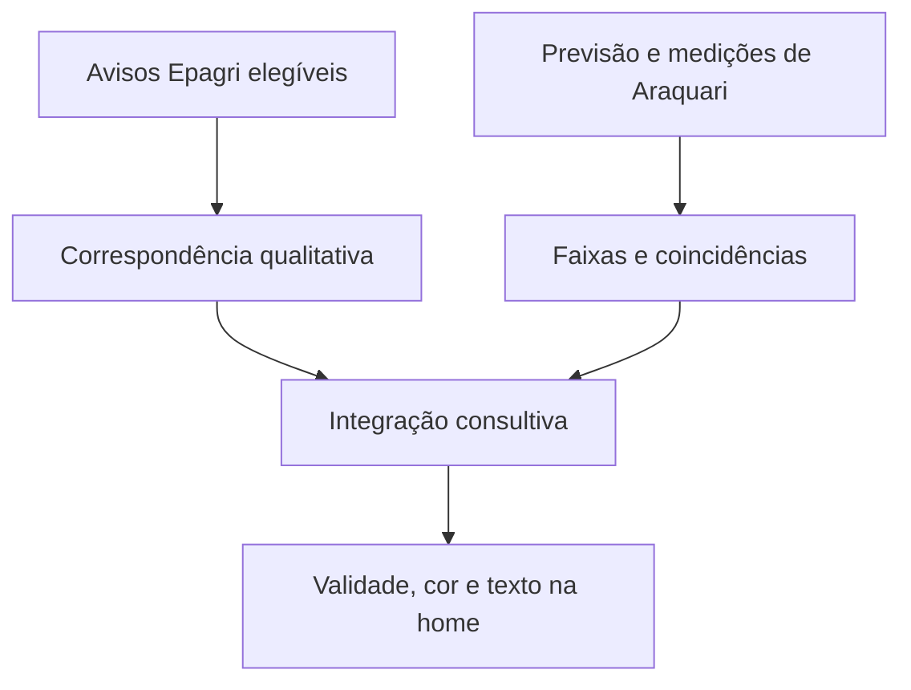

# Algoritmo da referência dos níveis da norma

Este documento descreve **o algoritmo implementado**, da entrada dos dados à cor exibida na home. Não é uma proposta de novos critérios. Conferido em 07/11/2026 contra o código-base `75f60f29e7bf2332a77e6edc95f8b1a6f1a39298`; a alteração de interface que acompanha esta documentação não modifica o classificador Python nem a função de apresentação dos níveis.

Versões publicadas: `numeric-support-v1` para o apoio quantitativo; `pn13-14-2026-multisource-v2` para a integração; `pn13-14-2026-v1` para a avaliação qualitativa original conservada em `base_assessment`.

## 1. O que significa a classificação

Há três resultados distintos, que não devem ser confundidos:

| Resultado | Onde está | Significado |
| --- | --- | --- |
| Nível formal | `assessment.official_level` | Permanece `null`. O aplicativo não declara um nível institucional oficial |
| Nível consultivo sugerido | `assessment.suggested_level` | Pode ser azul, amarelo, laranja ou vermelho, conforme os caminhos abaixo. É sugestão para avaliação humana |
| Referência visual da home | `web/dashboard.js:riskPresentation()` | Pode mostrar verde descritivo, amarelo por referências técnicas/contexto, a cor de um nível sugerido ou estado neutro. Nem toda faixa amarela significa `suggested_level = amarelo` |

`decision_automated` é `false`. A interface não determina funcionamento das atividades. As categorias de referência constam da [PN 13/2026, art. 6º](../web/references/pn-13-2026.pdf); a [PN 14/2026](../web/references/pn-14-2026.pdf) trata de reorganização acadêmica. A PN 13 prioriza a Epagri/Ciram, admite informação complementar e atribui decisões às autoridades competentes. **Os limiares numéricos abaixo são escolhas operacionais auxiliares do aplicativo; não são uma tabela de conversão criada por essas portarias.**

O campo `protocol.automatic_numeric_thresholds = false` refere-se à ausência de uma tabela numérica automática na norma. Não significa que o aplicativo deixe de usar números: `auxiliary_numeric_references = true` e o módulo quantitativo descrito aqui está ativo.

## 2. Caminho completo no código

1. [`scripts/build_site.py`](../scripts/build_site.py) coleta e normaliza as fontes e produz os arquivos JSON estáticos.
2. [`analysis.summarize()`](../src/observatorio/analysis.py) prepara previsões, observações e avisos **por município**. O registro principal é sempre `araquari`.
3. [`protocol.assess()`](../src/observatorio/protocol.py) procura correspondências qualitativas em avisos elegíveis da Epagri/Ciram.
4. [`objective_analysis.summarize()`](../src/observatorio/objective_analysis.py) calcula faixas de chuva/vento e coincidências observação–modelo para Araquari.
5. `objective_analysis.integrate()` combina os resultados. [`dashboard.summarize()`](../src/observatorio/dashboard.py) guarda a avaliação original em `base_assessment` e publica `data/dashboard.json`.
6. [`effectiveAssessment()` e `riskPresentation()`](../web/dashboard.js) verificam validade e escolhem o texto/cor da home.
7. [`assessment_history.merge()`](../src/observatorio/assessment_history.py) registra o estado calculado na publicação. Não reclassifica retrospectivamente episódios antigos.



## 3. Território: município, ponto do modelo e entorno

A referência numérica é o ponto aproximado de Araquari em [`config/locations.json`](../config/locations.json): latitude **−26,375**, longitude **−48,721**, IBGE **4201307**. É ponto de amostragem municipal escolhido pelo projeto, não coordenada de estação, centroide oficial, polígono municipal ou medição específica do campus. Distâncias são Haversine em relação a esse ponto, não ao campus.

A previsão utiliza a resposta Open-Meteo de `data/places/araquari.json`. A grade retornada pode ter coordenadas distintas do ponto solicitado, registradas em `grid_point`.

Os demais 19 municípios são contexto separado:

| Núcleo operacional | Municípios configurados |
| --- | --- |
| Norte de SC | Araquari, Joinville, Jaraguá do Sul, São Francisco do Sul, Itapoá, Garuva, Balneário Barra do Sul, Barra Velha e Guaramirim |
| Vale e foz do Itajaí | Blumenau, Itajaí, Navegantes, Penha, Balneário Piçarras, Gaspar e Pomerode |
| Grande Florianópolis | Florianópolis e São José/SC |
| Curitiba e planalto próximo | Curitiba e São José dos Pinhais/PR |

Esses núcleos são agrupamentos de organização, não áreas de equivalência climática. **O classificador quantitativo não soma, faz média ou busca o maior valor entre esses municípios.** A seleção de outro município em `dados.html` não muda a referência da home.

O filtro de chuva do entorno reutiliza, para visualização, até 24 estações geolocalizadas a até **40 km**, inclusive de outros municípios. É `regional_rain_context`; esse conjunto **não é passado ao apoio quantitativo do nível**. A exceção territorial relevante é vento/rajada METAR de aeródromo próximo, admitido até 25 km conforme a seção seguinte.

## 4. Quais fontes e variáveis entram

| Fonte/produto | Dados usados no algoritmo | Seleção e condições | Papel efetivo |
| --- | --- | --- | --- |
| Epagri/Ciram — avisos meteorológicos | Texto, regiões, início/fim explícitos e data de consulta | Até 8 publicações; critérios da seção 6 | Sugestão qualitativa e contexto prioritário |
| Open-Meteo — seleção automática `best_match` | Chuva horária, total de 24 h, máximos de vento e rajada; referências horárias para coincidências | Somente resposta de Araquari; coleta e referência atual com até 8 h | Apoio quantitativo previsto |
| Cemaden PED — acumulados municipais | Chuva medida em 1 h e 24 h, por código de estação | IBGE exatamente 4201307; regras temporais abaixo | Apoio quantitativo observado |
| NOAA/Aviation Weather Center — METAR | Vento e rajada medidos; não substitui um pelo outro | Aeródromo associado a Araquari, distância de 0 a 25 km e leitura com até 2 h | Apoio quantitativo observado |
| INMET — avisos municipais | Presença de avisos ainda não classificados como expirados e disponibilidade da consulta | Código IBGE municipal; consulta com até 6 h | Contexto e completude; a cor/severidade INMET não é convertida em nível IFC |

### 4.1 Cemaden: não há lista fixa de três estações no classificador

O coletor [`cemaden.py`](../src/observatorio/cemaden.py) consulta os acumulados recentes pelo IBGE e conserva a leitura mais recente por código, aceitando somente registros do município solicitado, com idade até 6 h e tolerância de até 10 min no futuro. Valores inválidos são descartados; ausência não vira zero. `analysis.observed_rain()` também exige consulta recente, estação recente e ao menos algum acumulado válido.

A classificação usa **todas as estações válidas retornadas para Araquari**, sem corte por quantidade e sem média municipal. Para cada uma:

- `rain_1h_mm`: leitura com até **1 h**;
- `rain_24h_mm`: leitura com até **6 h**;
- fim da janela = `observed_at`; início = esse horário menos 1 h ou 24 h;
- a distância é procurada por correspondência exata entre o código do pluviômetro e o cadastro já coletado em `cemaden_sensors.json`;
- coordenada ausente não impede o sinal de chuva local por IBGE, mas impede qualificá-lo como coincidência espacial verificada para a sugestão numérica laranja.

**Inventário observado, não lista obrigatória:** na publicação de **07/11/2026 às 09:56:18 de Brasília** (`generated_at = 2026-11-07T12:56:18Z`), `station_catalog` continha:

| Código Cemaden | Nome retornado | Município | Latitude / longitude | Distância ao ponto municipal |
| --- | --- | --- | --- | --- |
| 420130701A | Rainha | Araquari | −26,51683 / −48,71378 | 15,79 km |
| 420130702A | Porto Grande | Araquari | −26,41607 / −48,75515 | 5,69 km |
| 420130704A | Centro | Araquari | −26,37228 / −48,72337 | 0,38 km |

Novas estações elegíveis entram automaticamente; estações sem leitura recente podem sair dos sinais. O catálogo pode conservar estações presentes no histórico: **estar no catálogo não prova contribuição na classificação atual**. A lista decisiva é `assessment.numeric_support.signals`, cruzada por código com o catálogo e com `data/cemaden.json`.

### 4.2 METAR: conjunto consultado e filtro realmente usado

O coletor [`metar.py`](../src/observatorio/metar.py) consulta seis aeródromos:

| ICAO | Nome de referência configurado |
| --- | --- |
| SBJV | Joinville |
| SBNF | Navegantes |
| SSBL | Blumenau |
| SBFL | Florianópolis |
| SBCT | Afonso Pena / São José dos Pinhais |
| SBBI | Bacacheri / Curitiba |

O coletor mantém boletins de até 6 h, associa referências até 180 km e distingue observação principal até 100 km de contexto regional. Esses raios **não são o raio do classificador**. `analysis.recent_observations()` considera até as três primeiras referências locais, ordenadas por proximidade; `objective_analysis.summarize()` restringe novamente a **até 25 km e até 2 h**.

Na publicação de exemplo acima, SBJV aparecia a 21,0 km e fornecia vento, enquanto rajada ausente não gerava sinal. As outras cinco consultas não contribuem para o nível de Araquari apenas por estarem disponíveis. Distância e disponibilidade devem ser verificadas a cada publicação. A velocidade METAR é convertida de nós para km/h por fator **1,852**; nenhum boletim fornece, nessa integração, acumulado de chuva em milímetros.

### 4.3 Dados que não entram como gatilhos numéricos

Temperatura, sensação térmica, umidade, pressão, chuva de 3/6/12/48/72/96/120 h, NASA POWER, arquivo anual INMET, precipitação recente do adaptador INMET, cadastro Epagri, índices de qualidade regional, revisões entre previsões, histórico de estados e gráfico do entorno não determinam as faixas numéricas deste classificador.

ECMWF IFS, NOAA GFS e CPTEC são comparações/contexto, **não votos nem parcelas de uma média para definir o nível**. OpenWeather não é a integração utilizada. Publicações da Defesa Civil e boletins editoriais Epagri de 5/10 dias aparecem como informações complementares, mas não são entrada de `protocol.assess()` ou `objective_analysis.summarize()`.

Calor extremo, frio extremo e seca extrema podem ser reconhecidos **como texto de evento** num aviso Epagri elegível. Isso é diferente de aplicar um limiar numérico de temperatura. O valor descritivo de 30 °C não é gatilho de nível.

## 5. Preparação das séries numéricas

`analysis.fresh()` aceita idade entre −10 min e o limite de horas indicado. Horários precisam ter fuso; são normalizados em UTC. A tela usa `America/Sao_Paulo`.

Para a previsão, coleta e referência atual precisam ter até 8 h. `hourly_bins()` exige lista com até 500 linhas, horários de hora cheia e valores numéricos finitos, sem booleanos. Duplicatas idênticas são consolidadas; uma duplicata inválida ou divergente invalida aquela hora da variável. Limites de normalização: chuva horária 0–1000 mm, vento 0–400 km/h, rajada 0–450 km/h e temperatura −80 a 65 °C. São limites de validação, não faixas de risco.

Seja `T0` a hora UTC da publicação arredondada para baixo:

- **Chuva prevista:** os 24 términos de intervalo são `T0+1 h` a `T0+24 h`. O valor em `T` corresponde à hora anterior. A primeira barra pode incluir a hora em curso; não há rateio do restante da hora.
- O total precisa das 24 horas válidas. O apoio quantitativo reconfere a contagem e a soma com tolerância de **0,11 mm** em relação ao total publicado. Com essa verificação, cria um sinal para a maior chuva horária e outro para o total de 24 h.
- **Vento e rajada previstos:** cada variável exige 24 referências válidas de `T0` a `T0+23 h` para produzir seu máximo de 24 h. Em empate de máximo, `forecast_analysis()` prefere o horário mais cedo. São dois sinais independentes.
- Os sinais observados usam as janelas e os horários da própria estação, não a hora de publicação como se fosse a hora da medição.

A mediana exibida no cartão de chuva **não alimenta `band()`**. Ela é uma estatística descritiva de estações com términos a até 30 min da leitura mais recente, calculada somente com pelo menos três estações; os sinais de classificação permanecem individuais. Picos de 3/6 h e coincidência entre chuva e rajada futuras na análise descritiva também não são gatilhos adicionais.

## 6. Caminho qualitativo: Epagri/Ciram

### 6.1 Elegibilidade da fonte e do aviso

A fonte precisa ter `kind = epagri_ciram_official_advisories_not_civil_defense_alerts`, status `available`, `cached` ou `no_recent_notices`, e consulta `retrieved_at` com até **6 h**. A classificação examina no máximo **8 avisos**.

Cada aviso precisa ser um dicionário do tipo `epagri_meteorological_advisory_not_civil_defense_alert`, com URL HTTPS no host exato `ciram.epagri.sc.gov.br`, sem usuário/senha embutidos, e cumprir:

1. **Território explícito em `regions_text`:** Araquari; ou Litoral Norte, todas as regiões ou todo o estado. No segundo caso, a aplicação é regional, não confirmação municipal.
2. Textos de região contendo `exceto`, `excecao`, `menos` ou `nao inclui` não são automaticamente aceitos, mesmo que também citem Araquari/Litoral Norte.
3. **Janela explícita e conciliada:** início e fim com fuso, início menor que fim, fim posterior à publicação e início até **14 dias** à frente. Pode ser aviso futuro; não precisa já estar em curso.

O adaptador lê o RSS da categoria de avisos e suas páginas oficiais; procura `Início`/`Fim` com data e hora e a linha `Regiões`. Sem extrair esses campos, não inventa duração nem município. Conserva até 600 caracteres em `summary` e até 6000 em `assessment_text`. A avaliação usa `assessment_text`, ou `summary` se o primeiro estiver vazio. O coletor pode reutilizar cache; a elegibilidade continua exigindo a idade de `retrieved_at`, sem renovar artificialmente a consulta bem-sucedida.

### 6.2 Correspondências textuais exatas

`fold()` converte para minúsculas e remove acentos. É uma heurística literal, sem IA semântica, probabilidade ou leitura de imagens/mapas. As formas `sem`, `não há`, `não existe` e `descartado/descartada`, reconhecidas antes de termos de risco/perigo/temporal/tempestade/impacto, dentro da janela de até 55 caracteres da expressão regular, interrompem a correspondência desse texto. A regra não entende todas as formas de negação da língua portuguesa.

Precisa existir ao menos um evento reconhecido: tempestade, temporal/temporais, alagamento, inundação, enxurrada, deslizamento, vento forte, chuva intensa, calor extremo, frio extremo ou seca extrema. O código usa as formas/raízes em `event_pattern`; palavras numéricas isoladas não bastam.

As frases são delimitadas por ponto, ponto e vírgula ou quebra de linha. Uma expressão de risco ligada somente a Oeste, Sul, Planalto, Vale do Itajaí ou Florianópolis não eleva Araquari; a frase deve também conter a referência local/estadual reconhecida para superar essa restrição. Exclusões locais reconhecidas na frase são rejeitadas. É correspondência textual, não interseção de polígonos meteorológicos.

Ordem dentro de cada aviso elegível:

| Etapa | Condição implementada | Resultado |
| --- | --- | --- |
| 1 | Nenhum evento afirmativo/aplicável reconhecido, ou negação reconhecida | Nenhuma sugestão por esse texto |
| 2 | Evento reconhecido e início a **7 dias ou mais**, medidos em segundos/86400 a partir da publicação | Azul / Preparação. Essa etapa vem antes de procurar expressões de vermelho/laranja |
| 3 | Antes de 7 dias: `ameaça à/as vida`, `ameaça à integridade`, `perigo concreto`, ou tempestade/temporal severo e iminente com a proximidade textual prevista na regex | Vermelho / Alerta Máximo |
| 4 | Antes de 7 dias, sem a correspondência anterior: `risco alto`, `risco muito alto`, `risco elevado`, `alto risco` ou `alta probabilidade` | Laranja / Alerta |
| 5 | Sem as anteriores: alagamento, destelhamento, queda de árvore/galho, interrupção ou corte de energia | Amarelo / Atenção |
| 6 | Aviso elegível sem nenhuma correspondência acima | Aviso sob análise, sem nível sugerido |

As regex executadas estão integralmente em [`qualitative_match()` e `_applicable_clause()`](../src/observatorio/protocol.py). A tabela explica a lógica, mas não amplia o vocabulário do código. Entre vários avisos com sugestão, vence a ordem de maior nível: azul < amarelo < laranja < vermelho. Todas as evidências elegíveis continuam registradas. Esse parser **não emite verde ou roxo**.

## 7. Caminho quantitativo: faixas auxiliares

Cada sinal conserva `source`, `station`, `variable`, `value`, `unit`, `band`, `start_at`, `end_at`, `kind`, `distance_km` e `period_proxy`. `kind` distingue `forecast` de `observation`.

| Variável | Faixa 0 | Faixa 1 | Faixa 2 | Faixa 3 | Intervalo numérico aceito por `band()` |
| --- | --- | --- | --- | --- | --- |
| `rain_1h_mm` | 0 ≤ x < 20 | 20 ≤ x < 30 | 30 ≤ x ≤ 60 | x > 60 | 0–500 mm |
| `rain_24h_mm` | 0 ≤ x < 50 | Não existe | 50 ≤ x ≤ 100 | x > 100 | 0–1500 mm |
| `wind_kmh` | 0 ≤ x < 40 | 40 ≤ x < 60 | 60 ≤ x ≤ 100 | x > 100 | 0–400 km/h |
| `gust_kmh` | 0 ≤ x < 40 | 40 ≤ x < 60 | 60 ≤ x ≤ 100 | x > 100 | 0–450 km/h |

Valores fora desses intervalos, ausentes, booleanos ou não finitos **não geram sinal**. Faixa 0 é um valor válido abaixo das referências; não é preenchimento de dado ausente. Exatamente 30 mm/h ou 60 km/h entram na faixa 2; exatamente 60 mm/h e 100 km/h ainda ficam na faixa 2. Faixa 3 não significa automaticamente vermelho.

As referências externas citadas no próprio módulo são [aviso INMET 54644](https://avisos.inmet.gov.br/54644), [aviso 56310](https://avisos.inmet.gov.br/56310) e [tabela regional de tempo severo de outubro de 2021](https://portal.inmet.gov.br/uploads/notastecnicas/Tabela-MS_tempo-severo_23-e-24-10-2021.pdf). Os limites operacionais da implementação estão na tabela acima. **Não se apresenta essa discretização como alerta emitido pelo INMET ou equivalência oficial com as seis cores do IFC.**

Todo sinal de `rain_24h_mm`, previsto ou observado, recebe `period_proxy = true`: um acumulado móvel de 24 h não necessariamente coincide com o dia usado na referência diária. Ele é retirado do conjunto de sinais diretos para gerar sugestão e não participa das coincidências da seção seguinte.

## 8. Coincidências observação–modelo e proposta numérica

Para cada **sinal observado com faixa > 0 e `period_proxy = false`**:

1. Procura a mesma variável na série horária Open-Meteo de Araquari: `rain_1h_mm` corresponde a `precipitation_mm`; vento só compara com vento e rajada só com rajada.
2. Considera referências do modelo a até **60 min** do fim/horário da observação e escolhe a mais próxima. Em empate, conserva a primeira na ordem processada.
3. Exige que essa referência do modelo também tenha faixa > 0. Não usa o pico de outro horário futuro para confirmar uma observação passada.
4. Para chuva de 1 h, exige sobreposição estrita das janelas: `T_modelo > início_observado` e `T_modelo − 1 h < fim_observado`.
5. Registra os horários, diferença em minutos, as duas faixas e a distância normalizada/arredondada pelo processamento. `spatial_match_verified` só é verdadeiro com distância numérica de **0 a 25 km**.

A coincidência usa referências horárias válidas da resposta disponível, não exige que o ponto comparado seja o máximo de 24 h. A completude de toda a série é exigida para declarar aquele máximo, mas não é uma condição adicional para comparar um par horário válido. É coincidência contextual; não comprova independência entre fontes, equivalência entre estação e grade, precisão ou impacto no campus.

A proposta quantitativa segue exatamente esta prioridade:

```text
se existir coincidência com faixa observada >= 2,
   faixa do modelo >= 2 e distância verificada <= 25 km:
    proposed_level = laranja
senão, se existir sinal direto com faixa >= 2
        OU existir qualquer coincidência registrada:
    proposed_level = amarelo
senão:
    proposed_level = null
```

Consequências:

- Faixa 1 isolada não gera sugestão numérica, mas pode gerar atenção visual.
- Uma coincidência de faixas 1 pode gerar sugestão amarela. Para amarelo pela coincidência, a distância não precisa estar verificada; para laranja, precisa.
- Chuva horária de 30 mm ou rajada de 60 km/h, mesmo sem par compatível, pode gerar sugestão amarela.
- Faixa 3 isolada também não gera vermelho: no caminho numérico, continua sendo proposta amarela sem coincidência forte, ou laranja com ela.
- Acumulado de 24 h isolado não gera `proposed_level`, mas entra em `maximum_band` e pode produzir atenção na apresentação.
- Temperatura, número de municípios, quantidade de estações e soma de cores não são parcelas de um escore.

## 9. Integração, completude e estado interno

`integrate()` conserva a avaliação Epagri e o objeto quantitativo. Se a proposta numérica for **mais alta** que o nível qualitativo corrente, eleva a sugestão e registra `basis_kind = complementary_numeric_evidence`. Não reduz uma sugestão qualitativa já maior. Quando há nível qualitativo preservado, registra `primary_epagri_advisory`; sem sugestão, `monitoring_state`.

A prioridade Epagri **não é um veto absoluto ao apoio numérico**: a implementação permite sugerir amarelo/laranja mesmo sem correspondência qualitativa suficiente, ou elevar azul/amarelo quando a regra quantitativa justificar. Ausência da Epagri impede completude de rotina, mas não bloqueia a proposta quantitativa. Não há média nem votação.

`core_complete` é verdadeiro somente se todas estas condições de coleta forem verdadeiras:

1. previsão de Araquari `available`;
2. verificação completa e coerente da chuva prevista de 24 h;
3. máximos de vento **e** rajada com séries de 24 referências completas;
4. `observed_rain.status = available` para Araquari;
5. Epagri com status `available/cached/no_recent_notices` e consulta até 6 h;
6. consulta de avisos INMET municipais `available`.

**Limite dessa flag:** ela verifica disponibilidade dos componentes, não que todos os pluviômetros tenham todas as variáveis, nem que haja vento observado recente. `observed_rain = available` pode decorrer de outro acumulado válido da estação; a flag não exige explicitamente um sinal de chuva de 1 h em todas elas. Tetos numéricos do normalizador e de `band()` também são distintos. Sinais rejeitados não viram zero, mas `core_complete` não é uma auditoria adicional de cada sinal descartado. Essas são propriedades do código atual, não garantias de cobertura instrumental completa.

O primeiro caso atendido determina `monitoring_state`:

| Ordem | Condição | Estado |
| --- | --- | --- |
| 1 | Há `suggested_level` | `heightened` — acompanhamento reforçado |
| 2 | Não há sugestão e `maximum_band > 0` | `technical_attention` — referências de atenção |
| 3 | Sem as anteriores: existe aviso INMET não expirado ou evidência Epagri elegível | `official_context` — acompanhamento reforçado |
| 4 | Há evidência Epagri pendente de checagem territorial/temporal, com escopo reconhecido ou sem texto de regiões | `partial` — monitoramento parcial |
| 5 | Sem as anteriores e `core_complete = true` | `routine` — monitoramento de rotina |
| 6 | Demais casos | `partial` — monitoramento parcial |

No caso INMET, um aviso com janela não conciliada pode ter `lifecycle = unverified` e, portanto, não ser `expired`: ele serve como contexto, sem provar vigência, impacto ou nível. O aplicativo não converte diretamente sua severidade.

## 10. Cor e título realmente apresentados na home

Antes da cor, a página exige `dashboardCurrent`: publicação com idade até **3 h**, tolerância futura de 10 min e relógio anterior a `dashboard.valid_until`.

`effectiveAssessment()` verifica cada referência com `signalCurrent()`. Observações de chuva de 1 h vencem em fim da leitura +1 h; acumulados de 24 h em +6 h; vento/rajada METAR em +2 h. A tolerância futura continua em 10 min e o instante exato do vencimento já é excluído. Previsões permanecem como referências da janela publicada enquanto a publicação estiver válida, inclusive quando o horário de um máximo já passou; não são apresentadas como medições instantâneas.

Enquanto a avaliação integrada e todas as referências continuam válidas, usa-se o resultado publicado. Ao vencer uma referência ou a validade integrada, se a publicação e `base_assessment` continuam válidas, recalcula-se o apoio **somente com os sinais restantes**. Coincidências são mantidas apenas se a observação da mesma estação, variável e horário ainda estiver válida. Reaplicam-se os mesmos critérios de sugestão amarelo/laranja e a prioridade da sugestão Epagri, sem alterar faixas, distâncias ou janelas. Um acumulado móvel de 24 h continua podendo sustentar atenção técnica, mas não produz sozinho nível institucional sugerido.

`core_complete` só permanece verdadeiro nesse recálculo se nenhuma referência foi retirada e a cobertura publicada já estava completa: perder uma medição não permite converter a leitura em normalidade. Referências vencidas ficam em `expired_signals` na avaliação em memória; o JSON original não é alterado. O diálogo “Por que esta leitura?” informa a quantidade retirada e os métodos identificam individualmente as referências válidas/vencidas. Sem sinais elevados, avisos aplicáveis ou sugestão ainda válida, a leitura permanece parcial, com explicação do vencimento.

Regressão de 07/11/2026: a publicação das 11h50 tinha chuva horária até 11h47, vencendo às 12h47. Às 13h07, essa chuva horária deve ser excluída, mas o acumulado de 79,8 mm/24 h e a previsão de rajada de 49,3 km/h continuam válidos. A home mantém a referência amarela de atenção, sem atribuir nível institucional. Horários neste exemplo: Brasília.

Depois, `riskPresentation()` aplica esta ordem:

| Condição | Cor / texto |
| --- | --- |
| Publicação indisponível ou vencida | Neutro — Atualização necessária |
| Avaliação ausente ou vencida sem base ainda válida | Neutro — Dados insuficientes para classificar |
| `suggested_level` válido | Cor correspondente e nome da referência: Preparação, Atenção, Alerta ou Alerta Máximo |
| Sem sugestão, estado `routine`, `core_complete`, `maximum_band = 0` e pelo menos um sinal | **Verde — Normalidade nos dados acompanhados**, como descrição consultiva, não nível formal |
| Há ao menos um sinal numérico com faixa > 0 | **Amarelo — referência de atenção**, mesmo que não exista nível sugerido |
| Sem sinal elevado, mas estado `official_context` | **Amarelo — Há aviso meteorológico para conferir** |
| Outros casos | Neutro — Dados insuficientes para classificar |

Para compor a razão, a tela prefere sinais diretos a aproximações de 24 h e depois as faixas mais altas; apresenta até dois sinais. Distingue chuva e vento/rajada e identifica estação ou previsão para Araquari. Essa seleção de texto não recalcula nem faz média dos valores.

### As seis categorias, em termos operacionais

| Categoria da norma | Como aparece no algoritmo atual |
| --- | --- |
| Normalidade / verde | Não é sugerida pelo parser. Aparece na tela somente pelo conjunto de condições de rotina acima |
| Preparação / azul | Correspondência qualitativa de evento em aviso Epagri elegível com início em pelo menos 7 dias |
| Atenção / amarelo | Sugestão qualitativa, proposta numérica amarela ou referência visual técnica/contextual sem sugestão. Conferir `suggested_level` para distinguir |
| Alerta / laranja | Correspondência qualitativa de alto risco/probabilidade ou coincidência numérica forte, verificada no espaço/tempo |
| Alerta Máximo / vermelho | Correspondência qualitativa explícita de perigo/ameaça/iminência severa em aviso Epagri elegível. Não é produzido só por pico numérico |
| Calamidade / roxo | Categoria disponível para referência, mas **nenhum caminho automático atual a produz**. O código não verifica danos do campus, duração de desastre ou decretos para atribuí-la |

## 11. Validade, ausência de dados e histórico

Há relógios diferentes:

- `base_assessment.valid_until`: menor entre publicação +3 h, consulta Epagri +6 h e términos dos avisos elegíveis. Sem fonte Epagri válida, a avaliação insuficiente começa com prazo de 3 h.
- `numeric_support.valid_until`: começa em publicação +3 h e é encurtado pelas **observações com faixa > 0**: chuva 1 h vence em fim da leitura +1 h; chuva 24 h em +6 h; vento/rajada METAR em +2 h. Sinais de faixa 0 não encurtam esse prazo.
- `assessment.valid_until`: mínimo entre a validade qualitativa e a quantitativa no JSON publicado. O vencimento aciona a reavaliação individual no navegador; não descarta automaticamente todo o apoio numérico. A avaliação recalculada usa o prazo da base qualitativa, sempre limitada também pela validade da publicação e pelas verificações individuais a cada leitura.
- `dashboard.valid_until`: mínimo entre `analysis` de Araquari e a validade da avaliação qualitativa original. A validade da análise começa em +3 h e também considera a referência/coleta do modelo, avisos com fim conciliado e pares de temperatura aplicáveis, conforme `analysis.summarize()`.

A coleta é agendada a cada 40 min, sujeita a atraso do GitHub Actions. O navegador reavalia a validade a cada minuto e ao retornar à aba, mas **não coleta novos sensores nem recalcula faixas a partir de novos dados**. Entre publicações, remove referências vencidas, recalcula coincidências/sugestões com as restantes e impede normalidade quando houve perda de cobertura. Assim, a indicação descreve a coleta e seus prazos; não é monitoramento contínuo ou garantia de situação atual.

Falha de fonte, dado ausente, conflito, trecho sem amostra e leitura vencida não são preenchidos com zero. Uma condição abaixo das faixas não é prova de segurança. Não há verificação automática de alagamento no campus, queda de árvore, energia, estradas, granizo, raios ou decreto.

`assessment_history.json` grava `suggested_level` ou, quando nulo, `monitoring_state`. Por isso pode registrar `routine` enquanto a home apresenta verde descritivo. Os episódios mantêm versão e amostras por até 366 dias, limitados a 3000 episódios e 500 avisos. Mudança de estado/versão ou intervalo maior que 6 h inicia novo episódio. Duração entre coletas não prova permanência contínua do nível nem duração de desastre. O histórico observado de 7 dias e o filtro dos gráficos **não são usados para reclassificar a referência presente**.

## 12. Exemplos verificáveis

Exemplos sintéticos das regras, não medições atuais:

| Evidências válidas | Sugestão integrada, na ausência de nível qualitativo maior | Apresentação esperada |
| --- | --- | --- |
| Componentes completos, todos os sinais em faixa 0 e nenhum aviso/contexto pendente | `null`, estado `routine` | Verde descritivo |
| Rajada prevista 44 km/h, sem coincidência | `null`, `technical_attention` | Amarelo técnico |
| Rajada prevista 70 km/h, sem observação compatível | Amarelo | Atenção consultiva |
| Observação de rajada 75 km/h a 21 km e modelo 70 km/h no horário compatível | Laranja | Alerta consultivo |
| Chuva de 24 h de 120 mm, sem sinal horário direto elevado ou coincidência | `null`, `technical_attention` | Amarelo técnico, não vermelho |
| Aviso Epagri elegível com tempestade severa iminente e ameaça à vida, dentro de 7 dias | Vermelho | Alerta Máximo consultivo |
| Nenhum aviso e cobertura principal incompleta | `null`, `partial` | Neutro, não verde |

Exemplo **datado** da publicação usada para conferir o inventário: em `2026-11-07T12:56:18Z`, a rajada máxima prevista era 58,3 km/h (faixa 1), Porto Grande tinha 50,6 mm/24 h (faixa 2, `period_proxy`) e `monitoring_state` era `technical_attention`. Esses números explicam uma referência técnica amarela, não uma conversão automática de 50,6 mm em nível sugerido. Não use esse retrato como dado atual.

## 13. Como auditar uma publicação

No [site publicado](https://guimig.github.io/criseclimatica/), consulte os arquivos sob `data/`:

| Arquivo/campo | O que conferir |
| --- | --- |
| `dashboard.json`: `generated_at`, `valid_until` | Referência e validade da publicação |
| `assessment`: `suggested_level`, `official_level`, `basis_kind`, `monitoring_state`, `rule_version`, `valid_until` | Resultado integrado e motivo do caminho |
| `assessment.evidence[]` | Aviso, URL, regiões, janela, elegibilidade, expressão reconhecida e nível sustentado |
| `assessment.base_assessment` | Resultado prioritário anterior à integração e possível retorno após expiração |
| `assessment.numeric_support.signals[]` | Cada estação/modelo, variável, valor, faixa, período, distância e natureza |
| `assessment.numeric_support.coincidences[]` | Pares usados: horas, diferença temporal, faixas e distância verificada |
| `station_catalog[]` | Nome/código e metadados disponíveis; pode conter estações só históricas |
| `cemaden.json`, `cemaden_sensors.json`, `observations.json` | Leituras municipais, conciliação de códigos/coordenadas e METAR coletado |
| `places/araquari.json` | Série horária, ponto solicitado e grade do modelo |
| `epagri_notices.json`, `alerts.json` | Boletins e avisos que alimentaram os caminhos de contexto/classificação |
| `assessment_history.json` | Estado registrado a cada publicação; não confundir com a cor recalculada no navegador |

Para examinar um build já baixado ou gerado, sem expor credenciais:

```bash
python - <<'PY'
import json
from pathlib import Path
p = json.loads(Path('dist/data/dashboard.json').read_text())
a = p['assessment']
print(json.dumps({
    'publicacao': p['generated_at'],
    'validade_publicacao': p['valid_until'],
    'sugestao': a['suggested_level'],
    'nivel_formal': a['official_level'],
    'estado': a.get('monitoring_state'),
    'base': a.get('basis_kind'),
    'validade_avaliacao': a['valid_until'],
    'evidencias': a['evidence'],
    'apoio_numerico': a['numeric_support'],
    'estacoes': p['station_catalog'],
}, ensure_ascii=False, indent=2))
PY
```

A cor no navegador depende também do horário em que se abre a página e de `effectiveAssessment()`; o JSON sozinho, sem aplicar essa etapa, não prova qual faixa continua visível.

## 14. Verificação e manutenção

- [`tests/test_dashboard.py`](../tests/test_dashboard.py): território, janelas, negações, fonte prioritária e critérios qualitativos.
- [`tests/test_multisource_analysis.py`](../tests/test_multisource_analysis.py): limites das faixas, coincidências, distâncias, dados vencidos, aproximação de 24 h, integração e estados internos.
- [`tests/dashboard_behavior.cjs`](../tests/dashboard_behavior.cjs): validade e apresentação, verde descritivo, referências técnicas, retorno após expiração e dados ausentes.
- [`tests/test_analysis.py`](../tests/test_analysis.py), [`tests/test_reliability.py`](../tests/test_reliability.py) e [`tests/test_multi_sources.py`](../tests/test_multi_sources.py): normalização, completude e falhas das fontes.

```bash
python -m unittest discover -s tests -v
node tests/dashboard_behavior.cjs
node tests/web_reliability.cjs
```

Qualquer alteração em limiares, fontes, idades, distâncias, reconhecimento textual, integração ou apresentação deve atualizar este documento e os testes correspondentes. Mudanças da regra de classificação também exigem revisar as versões metodológicas e a continuidade do histórico. A documentação não deve anunciar um caminho que o código ainda não executa, sobretudo normalidade institucional ou calamidade automática.
